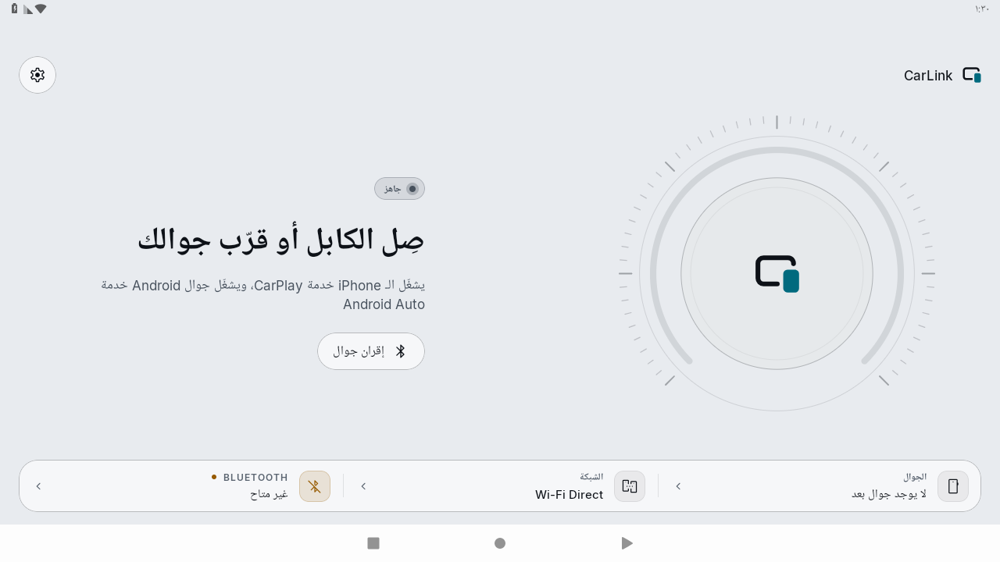
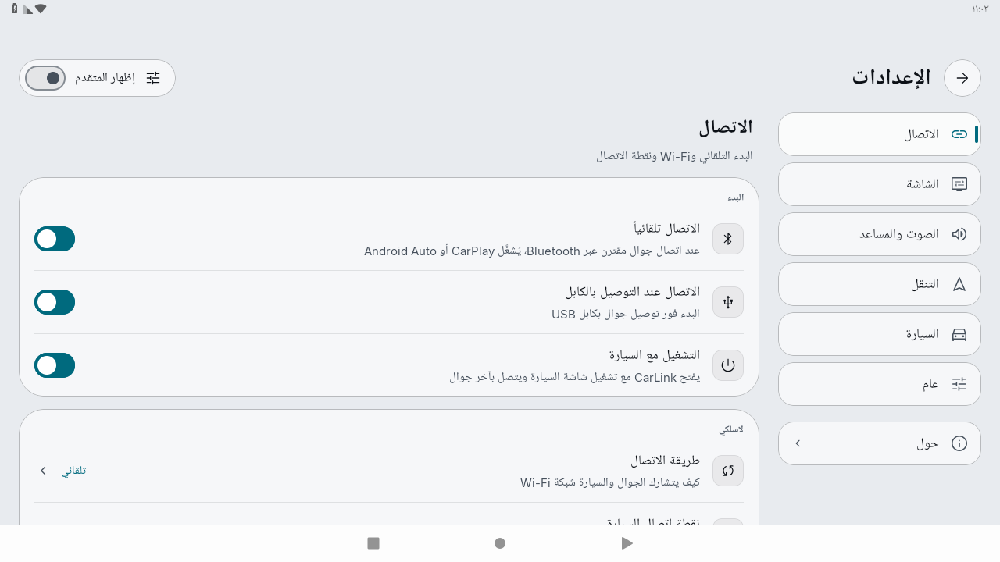
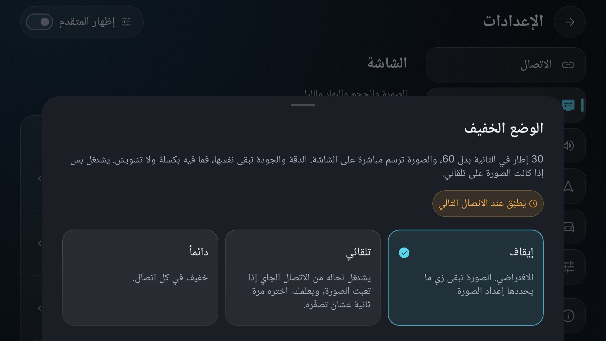
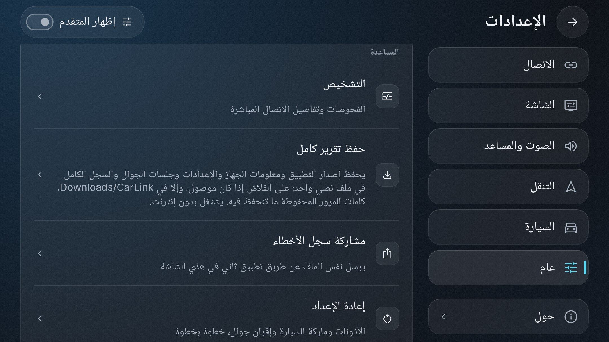
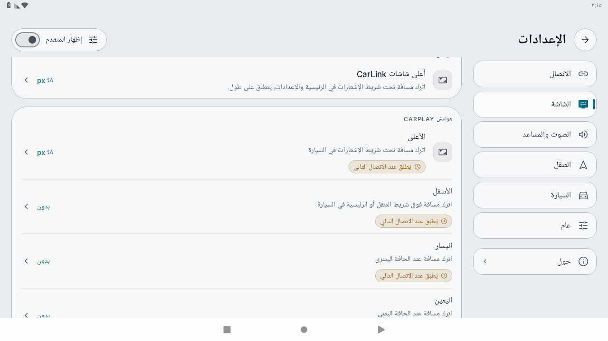
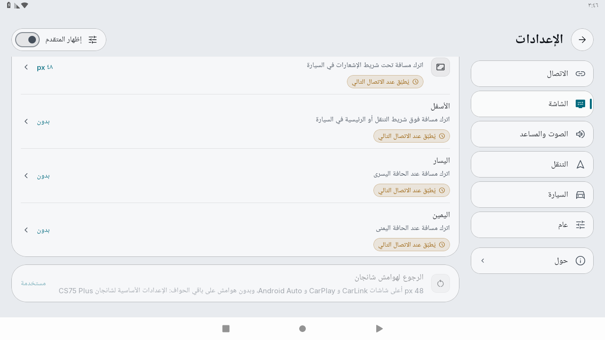
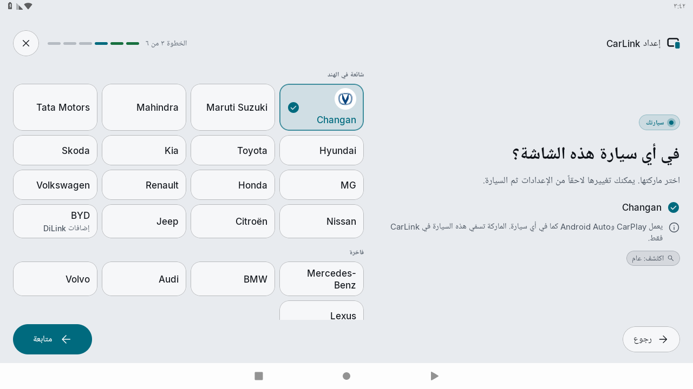
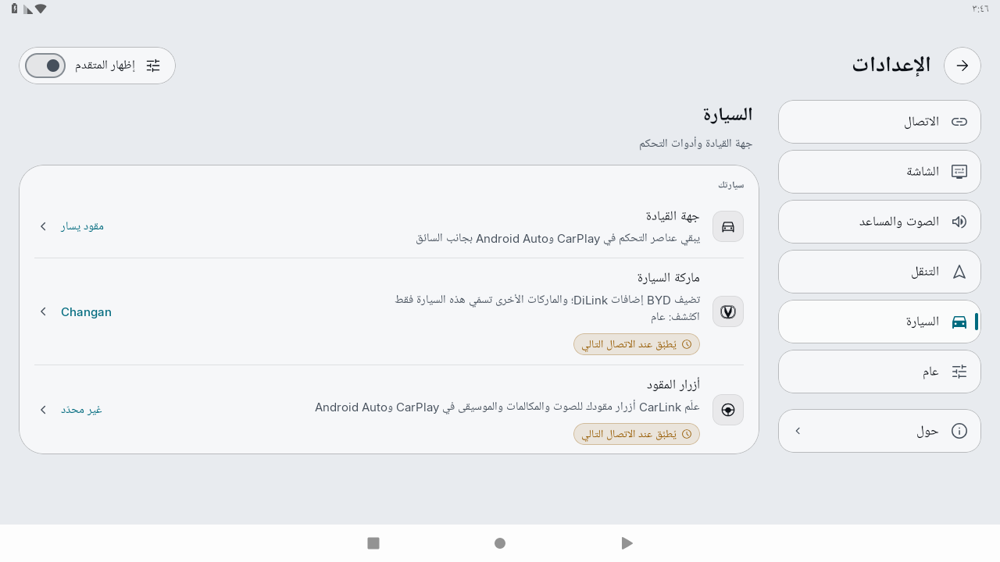
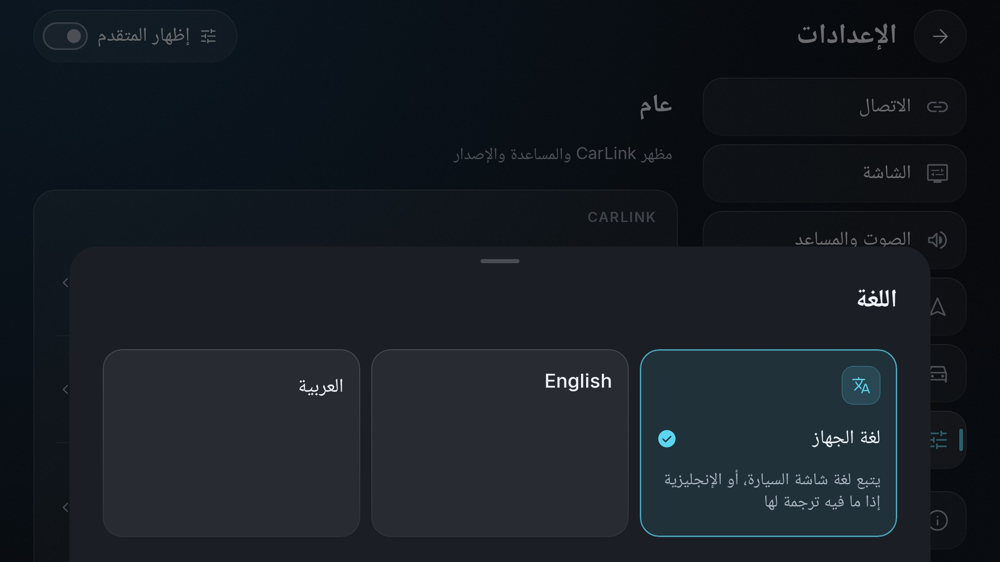
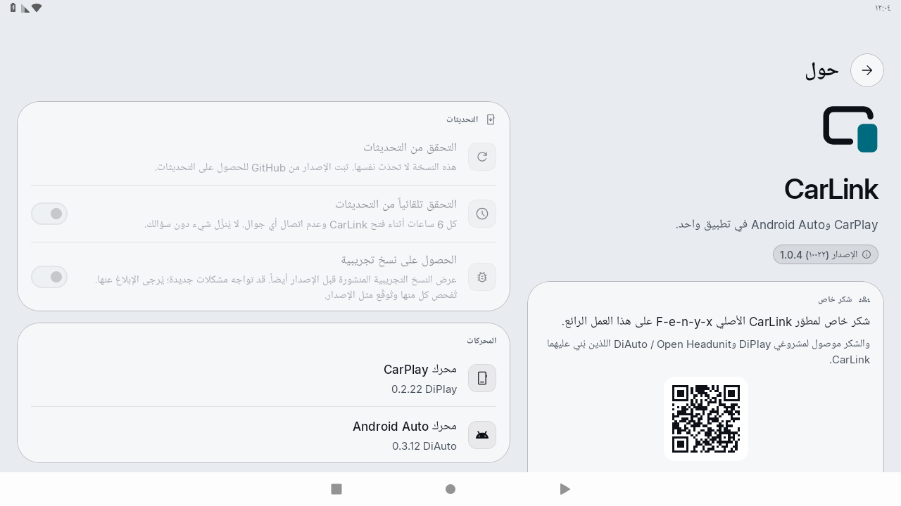

<picture>
  <source media="(prefers-color-scheme: dark)" srcset="docs/assets/carlink-mark-dark.svg">
  <source media="(prefers-color-scheme: light)" srcset="docs/assets/carlink-mark-light.svg">
  
</picture>
&nbsp;&nbsp;&nbsp;

# CarLink · شانجان CS75 Plus

**CarPlay و Android Auto في تطبيق واحد لشاشة شانجان CS75 Plus 2023 (النسخة السعودية).** 
**CarPlay and Android Auto in one app, for the Changan CS75 Plus 2023 head unit (Saudi version).**

[الميزات](#الميزات) · [الجديد](#الجديد-في-كل-نسخة) · [البناء](#البناء-والملفات-غير-المضمنة) · [شكر وتقدير](#شكر-وتقدير) · [English](#english)

> [!IMPORTANT]
> **هذا المستودع فيه الكود فقط:** ما فيه ملف تطبيق (APK) ولا ملفات مصادقة CarPlay (MFi). ملفات المصادقة يجيبها صاحب البناء بنفسه.
> **Source only:** no APK and no CarPlay (MFi) authentication files. Whoever builds it supplies their own.

ركّب CarLink على شاشة السيارة، ووصّل جوالك بالسلك أو لاسلكياً: **الآيفون يشتغل CarPlay** و**جوال الأندرويد يشتغل Android Auto**،
والتطبيق يعرف نوع الجوال لحاله. هذه النسخة معدّلة لشاشة **شانجان CS75 Plus 2023**: أندرويد 9 ومعالج Allwinner T7،
ومبنية على مشروع [CarLink الأصلي](https://github.com/F-e-n-y-x/CarLink) للمطوّر **F-e-n-y-x**.

<table>
  <tr>
    <td width="50%"> الشاشة الرئيسية · Home</td>
    <td width="50%"> الاتصال والتشغيل مع السيارة · Connection</td>
  </tr>
  <tr>
    <td> الوضع الخفيف (اختياري) · Lite mode (optional)</td>
    <td> حفظ تقرير كامل · Save full report</td>
  </tr>
  <tr>
    <td> هوامش الشاشة · Screen margins</td>
    <td> الرجوع لهوامش شانجان · Reset to Changan margins</td>
  </tr>
  <tr>
    <td> اختيار السيارة: شانجان مع شعارها · Car brand</td>
    <td> ماركة السيارة في الإعدادات · Car settings</td>
  </tr>
  <tr>
    <td> العربي والإنجليزي · Arabic and English</td>
    <td> حول CarLink وبطاقة الشكر · About and thanks</td>
  </tr>
</table>

الصور من محاكي أندرويد 9 أو مرسومة على الكمبيوتر (Robolectric) ببيانات تجريبية، مو من السيارة.

## الميزات

- **CarPlay و Android Auto معاً:** بالسلك أو لاسلكياً، والتطبيق يعرف الآيفون من الأندرويد بدون ما تختار.
- **خادم الوحدة الرئيسية لـ Android Auto:** إذا كان «Start head unit server» شغّال في الجوال والاثنين على نفس الشبكة، يتصل عن طريق المنفذ 5277 تلقائياً، والزر موجود كاحتياط.
- **اتصال أسرع:** يفتح مع تشغيل الشاشة، ويتصل بآخر جوال، ويجرّب أول الطريقة اللي نجحت آخر مرة.
- **الوضع الخفيف (اختياري، مطفّي افتراضياً):** إيقاف / تلقائي / دائماً. 30 إطار بدل 60 والصورة ترسم مباشرة على الشاشة، بنفس الدقة والجودة بدون بكسلة ولا تشويش.
- **ملف شانجان:** شانجان أول القائمة ومع شعارها ومختارة من أول تنصيب، وشعار شانجان على زر الرجوع للسيارة في CarPlay.
- **هوامش الشاشة:** هوامش منفصلة لـ CarPlay و Android Auto وشاشات CarLink، والافتراضي 48 px من فوق وصفر للباقي، مع زر «الرجوع لهوامش شانجان».
- **HEVC لـ CarPlay مفعّل من البداية:** ويرجع لـ H.264 تلقائياً إذا الشاشة ما تدعمه.
- **العربي والإنجليزي:** واجهة عربية مكتوبة يدوياً، والتبديل من الإعدادات › عام › اللغة.
- **حفظ تقرير كامل بضغطة:** إصدار التطبيق ومعلومات الجهاز والإعدادات والسجل الكامل في ملف واحد، على الفلاش أو في Downloads/CarLink، بدون كلمات المرور.
- **أزرار الطارة:** التالي/السابق/تشغيل-إيقاف توصل لـ CarPlay و Android Auto حتى لو التطبيق بالخلفية.
- **خفيف:** حجم أصغر (حوالي 17 ميجا) ومضغوط بـ R8، وبدون خدمات زيادة في الخلفية.

## المتطلبات

- **الشاشة:** شاشة شانجان CS75 Plus 2023 (أندرويد 9، Allwinner T7). ما يحتاج روت ولا تعديل على النظام.
- **الجوال:** آيفون لـ CarPlay أو جوال أندرويد لـ Android Auto، بالسلك أو بالبلوتوث والواي فاي للاسلكي.

## الجديد في كل نسخة

| النسخة | الجديد |
|---|---|
| CS75 Plus 2023 v1.0 | اسم جديد للنسخة مرتبط بـ CS75 Plus 2023 عشان ما تختلط بالمشروع الأصلي، وبدون أي تغيير في عمل التطبيق |
| 1.0.11 | CarPlay على 30 إطار افتراضياً في شانجان لتقليل التعليق، و60 متاحة من الإعدادات المتقدمة (معدل الإطارات) |
| 1.0.10 | تحديث أمني: مكتبة protobuf إلى 3.25.9 (CVE-2024-7254) |
| 1.0.9 | الوضع الخفيف الاختياري، اتصال أسرع بآخر طريقة نجحت، حفظ تقرير كامل على الفلاش، شعار شانجان في CarPlay، العربي والإنجليزي بس |
| 1.0.8 | كلمة «لاسلكي» في الدائرة الرئيسية صارت على نفس خط أيقونة الواي فاي |
| 1.0.7 | رسالة واضحة إذا علّق خادم الوحدة الرئيسية، وتحسينات في السجل وقائمة الخروج وشكل الأرقام |
| 1.0.6 | ملف شانجان مع الشعار، هوامش شانجان الافتراضية، HEVC لـ CarPlay |
| 1.0.5 وقبل | خادم الوحدة الرئيسية، هوامش الشاشة، اختيار اللغة، التشغيل مع السيارة، سجل الأخطاء، أزرار الطارة، بطاقة الشكر |

## البناء والملفات غير المضمنة

- **CarPlay يحتاج ملفات مصادقة (MFi) خاصة، وهي مو موجودة في هذا المستودع** ولن تُرفع له. صاحب البناء يوفّرها بنفسه.
- وقت البناء، المتغيّر `DIPLAY_AUTH_ASSETS_DIR` يشير لمجلد فيه `offline-mfi/`، وينسخ منه هذا المجلد بس داخل التطبيق.
- بدون المتغيّر يكتمل البناء عادي و Android Auto يشتغل، أما CarPlay فيعرض إن ملفات المصادقة ناقصة.
- تفاصيل البناء في [docs/BUILDING.md](docs/BUILDING.md).

## شكر وتقدير

مبنية على [CarLink](https://github.com/F-e-n-y-x/CarLink) للمطوّر **F-e-n-y-x**، مع شكر خاص له على هذا العمل الرائع،
وعلى محرّكَي [DiPlay](https://github.com/shihabal3amri/DiPlay) (CarPlay) و [DiAuto](https://github.com/shihabal3amri/DiAuto) / Open Headunit (Android Auto).
تفاصيل الرخص والشكر داخل التطبيق في «حول CarLink».

## الرخصة

الكود مرخّص تحت **GNU AGPL-3.0** مثل المشروع الأصلي ([LICENSE](LICENSE)).

## تنويه

شعار شانجان واسمها علامات تجارية مملوكة لشركة Changan Automobile، واستخدامها هنا للتعريف بالسيارة فقط.
هذا مشروع غير رسمي، ولا توجد أي علاقة مع الشركة. الشعار من [Wikimedia Commons](https://commons.wikimedia.org/wiki/File:Changan_icon.svg) (292Jacob، CC BY-SA 4.0)، وملفات الشعار هنا تبقى تحت نفس الرخصة.
CarPlay علامة تجارية لـ Apple، و Android Auto علامة تجارية لـ Google.

---

## English

Install CarLink on the car's screen and connect your phone by cable or wirelessly: an **iPhone gets CarPlay**, an
**Android phone gets Android Auto**, detected automatically. This build targets the **Changan CS75 Plus 2023 (Saudi
version)** head unit (Android 9, Allwinner T7) and is based on [CarLink](https://github.com/F-e-n-y-x/CarLink) by **F-e-n-y-x**.

### Features

- **CarPlay and Android Auto in one app**, wired or wireless, with automatic phone detection.
- **Android Auto head unit server:** with "Start head unit server" on in the phone and both on the same network, Android Auto connects through port 5277 automatically; the button stays as a backup.
- **Faster reconnect:** starts with the head unit, reconnects the last phone and tries the path that worked last time first.
- **Lite mode (optional, off by default):** Off / Auto / Always. 30 instead of 60 frames per second, drawn straight to the screen, same resolution and quality (no pixelation or blur).
- **Changan profile:** Changan first in the list with its logo, preselected on a fresh install; the Changan logo on CarPlay's back-to-car button.
- **Screen margins:** separate margins for CarPlay, Android Auto and CarLink's screens; 48 px at the top by default, with a "Reset to Changan margins" button.
- **HEVC on for CarPlay by default**, falling back to H.264 when the head unit has no hardware decoder.
- **Arabic and English:** hand-written Arabic UI; switch in Settings › General › Language.
- **One-tap full report:** version, device, settings and the full log in one file, on a USB flash drive or in Downloads/CarLink, without passwords.
- **Steering-wheel keys:** next/previous/play-pause reach CarPlay and Android Auto even in the background.
- **Light:** about 17 MB, R8-shrunk, no extra background services.

### Requirements

- **The display:** the Changan CS75 Plus 2023 head unit (Android 9, Allwinner T7). No root and no system changes.
- **The phone:** an iPhone (CarPlay) or an Android phone (Android Auto), with a cable, or Bluetooth and Wi-Fi for wireless.

### What's new

| Version | Changes |
|---|---|
| CS75 Plus 2023 v1.0 | New version name tied to the CS75 Plus 2023, so it is not confused with the original project; no functional change |
| 1.0.11 | CarPlay at 30 fps by default in a Changan to reduce stutter; 60 still available in Advanced settings |
| 1.0.10 | Security update: protobuf library to 3.25.9 (CVE-2024-7254) |
| 1.0.9 | Optional Lite mode, faster reconnect on the last working path, one-tap full report to USB, Changan logo in CarPlay, Arabic and English only |
| 1.0.8 | The Arabic "Wireless" label in the home dial lines up with its Wi-Fi glyph |
| 1.0.7 | Clear message when the head unit server is stuck; log, exit menu and number-style fixes |
| 1.0.6 | Changan profile and logo, Changan default margins, HEVC for CarPlay |
| 1.0.5 and earlier | Head unit server, screen margins, language picker, start with the car, error log, wheel keys, thanks card |

### Building and what's not included

- **CarPlay needs private MFi authentication files, which are not in this repository** and never will be; whoever builds supplies their own.
- At build time the `DIPLAY_AUTH_ASSETS_DIR` environment variable points to a folder containing `offline-mfi/`; only that folder is copied into the app.
- Without it the build still completes and Android Auto works; CarPlay reports that authentication assets are missing.
- Build details are in [docs/BUILDING.md](docs/BUILDING.md).

### Credits

Based on [CarLink](https://github.com/F-e-n-y-x/CarLink) by **F-e-n-y-x**, with special thanks for the original work, and on the
[DiPlay](https://github.com/shihabal3amri/DiPlay) (CarPlay) and [DiAuto](https://github.com/shihabal3amri/DiAuto) / Open Headunit
(Android Auto) engines. Licences and credits are in the app under About CarLink.

### License

Licensed under the **GNU AGPL-3.0**, like the original ([LICENSE](LICENSE)).

### Trademarks

The Changan name and logo are trademarks of Changan Automobile, used here only to identify the car.
This is an unofficial project with no connection to the company. Logo from
[Wikimedia Commons](https://commons.wikimedia.org/wiki/File:Changan_icon.svg) (292Jacob, CC BY-SA 4.0); the logo files here stay under that licence.
CarPlay is a trademark of Apple Inc.; Android Auto is a trademark of Google LLC.
